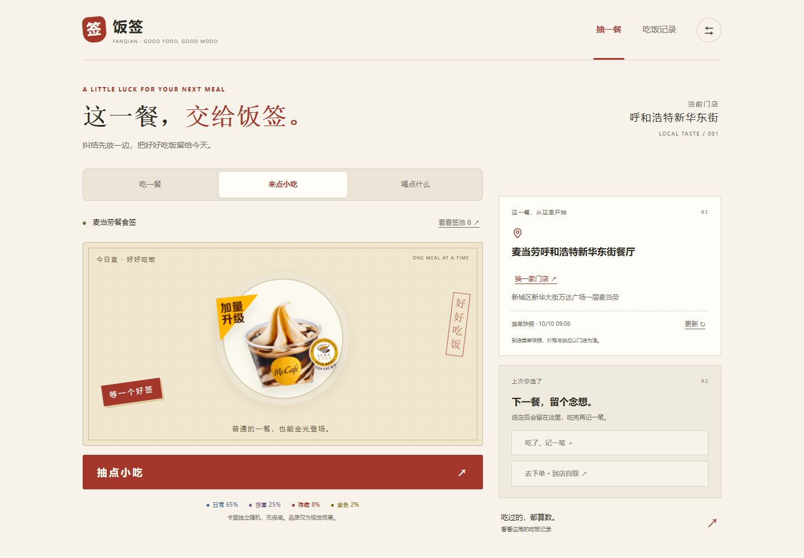
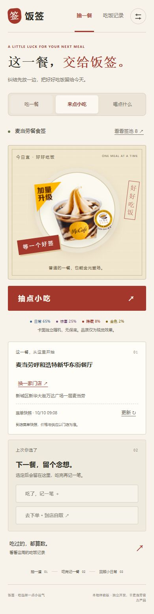
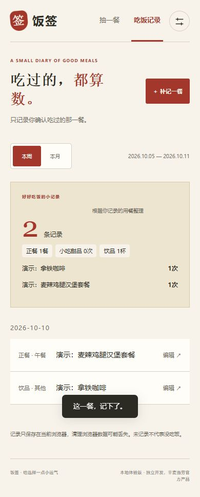

# 饭签 · 这一餐，交给饭签

不知道吃什么？从麦当劳真实门店菜单抽一个建议，查看默认搭配与可用优惠，吃完再记一笔。

饭签面向饭点容易纠结的学生、上班族，以及喜欢轻量抽卡体验的麦当劳用户。它将“选择下一餐”和“记录实际吃过的餐食”分开：抽中、选定、下单均不会自动算作吃过。

这是麦当劳程序员创意开发大赛参赛准备项目，由 [sssefo](https://github.com/sssefo) 独立开发，非麦当劳官方产品。当前交付为使用麦当劳 MCP 的本地网页应用。

## 演示



| 手机首页 | 用餐回顾（演示记录） |
| --- | --- |
|  |  |

## 能做什么

- 从套餐、小吃甜品、饮品咖啡三个真实菜单签池抽取，避开最近三次结果；蓝紫红金只代表卡面表现，与价格、优惠和奖品无关。
- 按城市和商场、街道或地标搜索门店，切换后查询对应菜单；支持签池启停、默认搭配查询及手动更新。
- 选定餐品后，核算默认规格的到店外带自取价格，比较不用券与可识别的已持有单券方案。同价优先不用券，每次最多试算20张。
- 用户在订单确认页勾选确认后才创建订单；提交前再核价，变价或券失效需再次确认。未知提交结果停止重试，避免重复下单。
- 快捷记录选定餐品，或手动补记、编辑、删除；按北京时间查看本周、本月的正餐、小吃和饮品统计，以及最常吃的前三项。
- 可关闭声音或简化动效；记录保存在当前浏览器，读取损坏或保存失败时有提示。

## 安装与启动

需要 **Node.js 22 或以上**。没有第三方运行依赖，无需执行 npm install。

1. 下载仓库 ZIP 并解压，或克隆仓库，然后在项目目录打开终端。
2. 从 [麦当劳 MCP 官方指南](https://github.com/M-China/mcd-mcp-server)申请自己的 Token。将 `.env.example` 复制为 `.env.local`，在本机编辑 `MCD_MCP_TOKEN`。不要把 Token 发到聊天或上传 GitHub。
3. 初始化真实公共门店和菜单：

   ```sh
   npm run setup
   ```

4. 启动服务：

   ```sh
   npm run dev
   ```

5. 打开 [http://127.0.0.1:4173](http://127.0.0.1:4173)，保持终端运行；Ctrl+C 停止。Windows 也可双击 `start-demo.cmd`。

初始门店为呼和浩特新华东街餐厅（1980064）。初始化只查询公共门店和菜单，不领券、不创建订单；进入页面后可换店。首次初始化需要联网和有效 Token。若默认门店不可查询，初始化会报错而保留已有快照，请稍后重试。

`npm run setup` 会更新 `.local/stores.json` 和 `.local/meals.json`，不会删除订单日志或浏览器记录。不要删除 `.local/orders.json`，它用于重启后的防重复提交。

## 使用示例

**决定下一餐：** 选择“套餐” → 点击“抽一餐” → 查看结果或默认搭配 → “就吃这个”。这里只保存选择。

**记录真实用餐：** 吃完点击“吃了，记一笔” → 确认菜名、日期、类别和餐次 → 保存 → 查看本周或本月。正餐同日同餐次冲突需确认替换；小吃与饮品可记多条。

**比较优惠并自取：** 换到你要去的门店 → 重新抽取并选定 → “去下单 · 到店自取” → 核对数量、默认搭配、优惠与实时金额 → 明确确认后提交。订单创建后通过官方链接或麦当劳 App 完成支付；下单不自动记餐。

## MCP 与验证

真实使用的工具：`query-nearby-stores`、`query-meals`、`query-meal-detail`、`query-store-coupons`、`calculate-price`、`create-order`、`query-order`。详细流程、业务价值及验证范围见 [MCP_INTEGRATION.md](MCP_INTEGRATION.md)。

```sh
npm test              # 本地模拟与业务测试，无需 Token
npm run check:config  # 仅检查 Token 配置，不联网
npm run check:mcp     # 联网初始化并读取工具列表
```

截至2026-10-10，已有真实门店、菜单、详情、算价及空优惠券列表的验证记录。创建订单、查询订单和非空优惠券分支以模拟方式验证；真实创建响应及支付闭环尚未验证。测试和安装复现证据见 [验证记录](docs/VALIDATION.md)。

## 数据与边界

Token 只由本机服务读取，固定发送至 `https://mcp.mcd.cn`，不进入网页。`.env.local` 和 `.local/` 被 Git 忽略；公开 [MCP 配置示例](mcp-config.example.json) 仅包含环境变量占位符。各 MCP 客户端的变量插值语法可能不同。

这是使用各自 Token 的本地单用户应用。不能把个人 Token 作为所有访客共享的下单账号部署。记录仅在当前浏览器，无账号、云同步和导出；清理浏览器数据可能丢失记录。

门店搜索按填写的地点查询，未使用 GPS，不承诺按实际距离排序。菜单展示参考价；实时金额以算价和官方渠道为准。优惠推荐仅覆盖可识别、试算通过的同餐品同数量单券，不叠券、不领券、不加购会员。

## 项目结构

| 路径 | 职责 |
| --- | --- |
| `demo/dist/` | 直接运行的前端源码，HTML、CSS 和原生 JavaScript；不是需要重新构建的产物 |
| `demo/server.mjs` | 本地 HTTP 服务与 API 路由 |
| `demo/menu-*.mjs` | 菜单清洗、门店登记和各店独立缓存 |
| `demo/checkout-*.mjs`、`demo/coupon-service.mjs` | 默认搭配、报价、优惠比较和订单防重复 |
| `scripts/` | MCP 协议、参数校验、配置检查及菜单初始化 |
| `tests/` | Node.js 内置测试 |
| `docs/` | 演示截图、验证记录、参赛交付说明 |

本仓库交付麦当劳 MCP 相关的网页应用、接入脚本、测试与参赛材料，实际范围以本 README 和源码为准。

## 参赛与素材说明

参赛声明使用官方原文：[CONTEST_DECLARATION.md](CONTEST_DECLARATION.md)。只有官方报名 Issue 收到成功回复后，才算报名成功。

界面、占位 SVG 与音效由本项目实现；餐品图片由麦当劳菜单返回，运行时从官方图片域名加载。历史参考网站截图仅留在本机，不纳入公开源码交付。原创性和第三方素材使用权须由参赛者在报名时确认。
