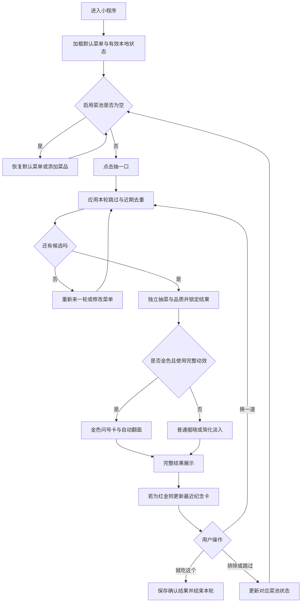
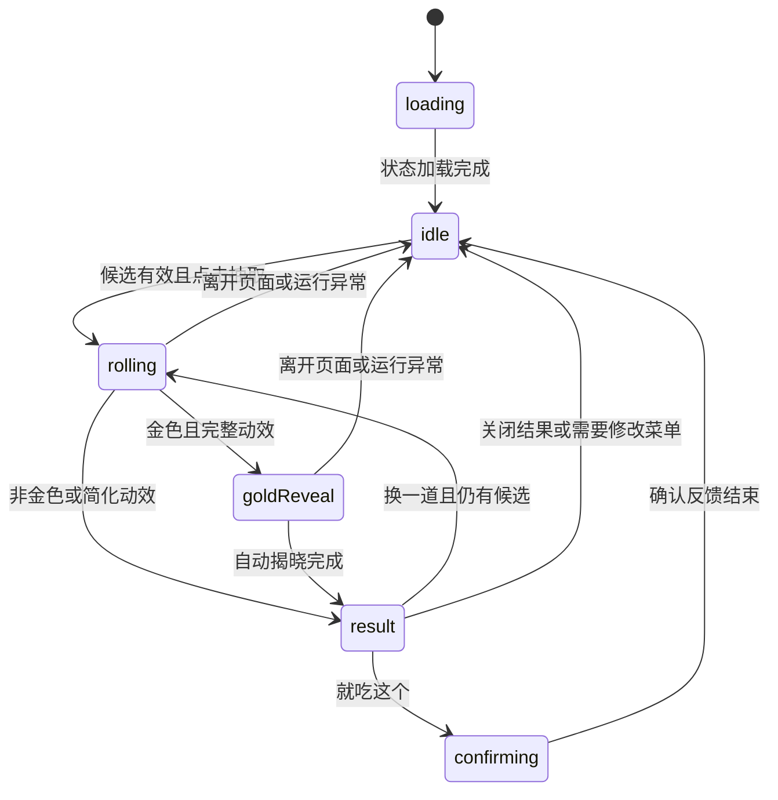
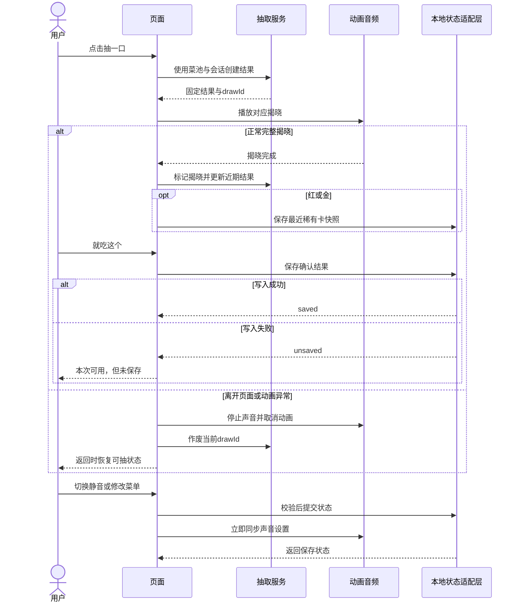
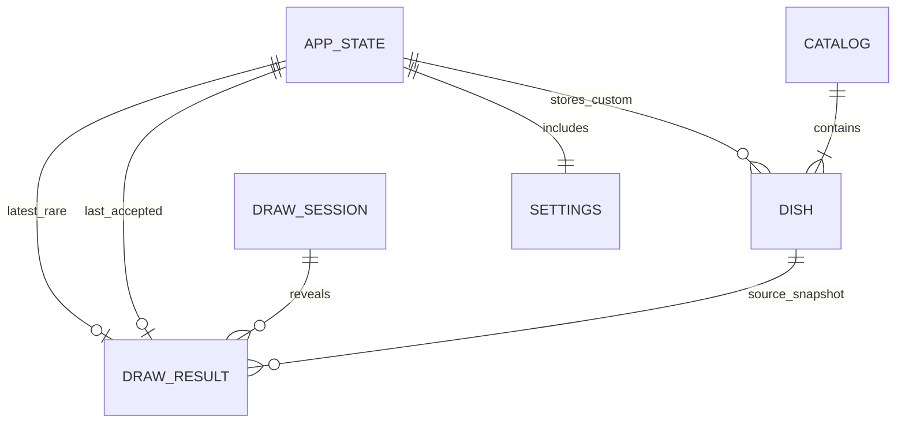

# 饭签｜微信小程序产品方案与需求说明

> 历史版本：首版范围已由[产品方案 V1.1](饭签_微信小程序产品方案_V1.1.md)取代。开发请使用 V1.1 的“抽取＋用餐记录＋周／月回顾”范围；本文件保留原方案供追溯。

> 一款打开就能玩的吃饭抽签小游戏。先抽今天吃什么，再独立抽出蓝、紫、红、金卡面；普通的一碗饭，也能金光登场。

## 1. 文档信息

| 项目 | 内容 |
|---|---|
| 产品暂定名 | 饭签（名称待最终确定） |
| 文档版本 | V1.0 |
| 日期 | 2026-10-08 |
| 目标平台 | 微信小程序 |
| 文档性质 | 已确认产品方向的首版需求基线；具体实现与美术尚未开发 |
| 产品定位 | 偏游戏体验的轻量吃饭抽签工具 |
| 核心用户 | 午餐选择困难的学生、上班族，以及愿意体验趣味开箱的用户 |
| 核心价值 | 零准备即可抽取；三秒左右获得结果；通过出红、出金制造惊喜 |
| 首版架构原则 | 本地菜单、本地抽取、本地保存；核心流程不依赖自建业务后端 |
| 参考项目 | https://github.com/truanayangi-com/truanayangi |

### 1.1 已确认方向与设计取值

已确认：先做简单、偏游戏的抽取；内置菜单，不要求用户先维护；引入蓝紫红金；菜品与品质独立抽取；稀有度不绑定价格；首版不做复杂养成。

本方案沿用以下设计取值：48 道内置菜、最多 30 道自定义菜、最近 3 个结果去重、蓝紫红金概率为 65% / 25% / 8% / 2%。这些是首版设计参数，不是已经验证的运营结论；上线前可以通过试玩统一调整，调整时需同步概率说明和验收用例。

### 1.2 与原项目的关系

参考仓库审查基于提交 `2e10968abfcee2cabc0b01fcf0535ac4aa31b16d`。其公开版本为 React + TypeScript + Vite 静态前端，含菜池管理、价格加权选择、动画和音频模块，不含官网生产后端。

本次为新的微信小程序方案：保留菜池校验和开箱表现的思路，界面、动画、存储和概率规则重新实现。原项目的价格加权算法不进入首版。原图片、音效不能直接视为可自由再授权资源，首版使用原创或已明确取得适用授权的素材。

### 1.3 术语与优先级

| 术语 | 定义 |
|---|---|
| 菜池 | 当前启用的内置菜与自定义菜的集合 |
| 品质 | 一次抽取卡面的表现等级，与食物价格、品质或实际奖品无关 |
| 出红 / 出金 | 抽中红色 / 金色卡面 |
| 重抽 | 重新抽取菜品，同时重新抽取品质 |
| 接受结果 | 点击“就吃这个”，表示接受建议，不代表实际已用餐 |
| 稀有纪念卡 | 最近一次完整揭晓的红色或金色结果快照 |
| P0 | 首版核心，缺失则不能发布 |
| P1 | 首版计划包含的趣味增强；不得影响 P0 可用性 |
| P2 | 后续候选，本轮不实现 |

### 1.4 成功判断

先验证三件事：用户能否无讲解完成首次抽取；是否喜欢揭晓体验；几天后是否会在饭点主动再用。

首轮建议邀请 15–20 位目标用户体验一周。记录首次完成情况、重抽原因、接受结果情况和主动回访反馈。接受率、留存率的业务门槛待试用基线建立后确定，不以“抽取次数越多越好”代替判断。首版不因测量需要强制增加账号或远程行为采集。

## 2. 用户角色与场景

首版只有普通使用者；“新用户”“回访用户”是使用状态，不是不同权限角色。菜单内容维护由项目开发流程完成，不建设管理后台。

| 场景 | 用户目标 | 入口 | 结束条件 |
|---|---|---|---|
| 第一次体验 | 不做设置就抽一次 | 首页 | 看到完整结果 |
| 决定午餐 | 从建议中选一道 | 首页 / 换一道 | 点击“就吃这个” |
| 娱乐重抽 | 体验稀有揭晓 | 结果弹层 | 自主停止，不限制次数 |
| 调整口味 | 排除不吃的菜、加入常吃的饭 | 结果菜单 / 菜单页 | 调整成功并得到保存反馈 |
| 纪念结果 | 留住最近一张红金卡 | 首页纪念卡入口 | 查看或保存图片 |

| 编号 | 优先级 | 用户故事 |
|---|---|---|
| US-001 | P0 | Given 首次进入且没有本地数据，When 点击“抽一口”，Then 使用默认菜单完成抽取，And 不要求登录或编辑菜单。 |
| US-002 | P0 | Given 已揭晓结果，When 点击“换一道”，Then 同时重新抽菜与品质，And 按最近结果规则排除重复菜。 |
| US-003 | P0 | Given 已揭晓结果，When 点击“就吃这个”，Then 显示简短确认反馈，And 首页记录上次确认的菜。 |
| US-004 | P0 | Given 抽到不吃的菜，When 选择“以后不抽到”，Then 将其移出菜池，And 用户可以撤销或在菜单页恢复。 |
| US-005 | P0 | Given 用户添加自己的菜，When 保存有效名称，Then 新菜加入菜池，And 拥有与其他菜相同的抽中机会。 |
| US-006 | P1 | Given 完整揭晓一张红金卡，When 返回首页，Then 可以再次查看最近稀有卡，And 重抽不会立即删除它。 |

## 3. 功能详细说明

### 3.1 范围总览

| 编号 | 功能 | 优先级 | 首版范围 |
|---|---|---|---|
| F-001 | 首页与抽取 | P0 | 默认菜池、抽取入口、上次确认结果 |
| F-002 | 品质与揭晓 | P0 | 蓝紫红金、独立概率、金色二次揭晓 |
| F-003 | 结果操作 | P0 | 接受、重抽、本轮跳过、长期排除 |
| F-004 | 菜单管理 | P0 | 启用 / 排除 / 恢复 / 添加 / 编辑 / 删除 |
| F-005 | 设置与本地保存 | P0 | 声音、简化动效、失败提示 |
| F-006 | 最近稀有纪念卡 | P1 | 仅保留最近一张红或金卡，不做背包 |
| F-007 | 保存结果图片 | P1 | 本地生成静态卡片、用户主动保存 |

不进入首版：金币、签到、升级、任务、付费抽取、广告换次数、完整图鉴、账号同步、定位、附近商家、下单、优惠券、多人房间、群投票、菜单导入导出、主题商店。

### 3.2 F-001：首页与抽取

首页结构：产品名与设置入口 → 抽取舞台 → “抽一口”按钮 → 上次确认结果 → 菜单入口 → 有内容时显示最近稀有卡入口。

| 字段 | 说明 |
|---|---|
| activeCount | 当前启用菜品数，用于空状态和单菜状态 |
| drawState | idle / rolling / goldReveal / result / confirming |
| lastAccepted | 最近一次用户确认的结果快照，可为空 |

- BR-001：首次打开使用内置菜单，不弹出必须填写的引导表单。
- BR-002：抽取中锁定抽取按钮和菜单修改入口；不能重复创建抽取。
- BR-003：完成一次抽取不等于接受结果，只有“就吃这个”更新 `lastAccepted`。
- BR-004：首页表述为“上次你选了”，不写“上次你吃了”。

约束：核心结果不能依赖素材全部加载完毕；素材失败时使用占位图完成流程。

### 3.3 F-002：品质与揭晓

| 品质 | 标识 | 概率 | 卡面表现 | 示例文案 |
|---|---|---:|---|---|
| 蓝色·日常款 | blue | 65% | 蓝色边框、普通揭晓 | 今天吃：黄焖鸡米饭 |
| 紫色·加料款 | purple | 25% | 紫色光效、专属短句 | 黄焖鸡米饭 · 干饭状态拉满 |
| 红色·隐藏款 | red | 8% | 红色光效、强化音效 | 黄焖鸡米饭 · 今日饭王 |
| 金色·传说款 | gold | 2% | 金色问号卡停住，再自动翻面 | 金色传说 · 天选黄焖鸡 |

“加料款”“隐藏款”等均为卡面称号，不承诺加料、优惠或实物奖励。称号与结果文案为示例，上线前统一校对。

| 字段 | 说明 |
|---|---|
| rarity | blue / purple / red / gold |
| rarityConfigVersion | 本次使用的概率配置版本 |
| captionId / captionText | 选定文案及其快照，不在每次重新渲染时变更 |
| reducedMotion | 是否使用简化揭晓 |

- BR-005：先等概率抽菜，再使用一次独立随机取值抽品质；不依据菜价、名称、是否自定义改变品质概率。
- BR-006：对均匀随机值 r ∈ [0,1)，[0,0.65) 为蓝，[0.65,0.90) 为紫，[0.90,0.98) 为红，[0.98,1) 为金。
- BR-007：首版无保底、连抽加成或“接受结果后提高概率”；2% 不代表每 50 次必出一次金。
- BR-008：结果在动画前确定，动画结束展示同一结果，不能根据动画停点重新抽取。
- BR-009：概率说明可从首页设置或结果说明入口查看，展示四档概率、独立抽取和无保底规则。
- BR-010：正常首次动画目标约 3 秒，连续重抽约 1.5 秒，金色额外增加约 1 秒自动翻面。以上为设计目标，允许动画实现时小幅统一调整。
- BR-011：简化动效不播放长距离滚动和强闪烁，使用不超过 0.5 秒的淡入；金色可直接展示金色成品卡，不要求额外点击。

约束：音效与卡面均使用原创或已授权资源；稀有度不能只靠颜色表达，必须同时有文字标识。滚动中的填充卡片属于装饰，不对它们的出现频率作概率承诺，不专门安排“差一点出金”的误导性停点。

### 3.4 F-003：结果操作与防重复

主要按钮为“就吃这个”“换一道”，次要入口为“我不吃这个”，展开“这轮先跳过”“以后不抽到”。

| 字段 | 说明 |
|---|---|
| recentDishIds | 当前连续抽取会话中最近 3 个已完整揭晓结果的菜品 ID |
| sessionSkippedIds | 用户本轮明确跳过的菜品集合 |
| result | 本次结果快照 |

- BR-012：先从启用菜池移除本轮明确跳过的菜，再排除最近 3 个结果；对剩余候选等概率抽取。
- BR-013：若仅因最近结果排除导致候选为空，按最旧到最新顺序逐项释放最近结果，直到出现候选。
- BR-014：本轮明确跳过与长期排除不能被上述降级自动释放。若本轮全部跳过，提示“这轮都看过了”，用户可选择“重新来一轮”清空本轮跳过，或去修改菜单。
- BR-015：只有一道可抽菜时说明“现在只有这一道”，允许直接接受或继续抽卡面；不伪装成存在其他菜品选择。
- BR-016：“换一道”只影响近期防重复，不修改长期口味；“这轮先跳过”跳过当前菜并尝试继续；“以后不抽到”禁用当前菜，显示成功反馈与撤销入口，由用户决定是否继续抽取。
- BR-017：会话从首次抽取开始，点击“就吃这个”或冷启动小程序后结束 / 重置。关闭结果弹层不自动清空本轮去重记录。
- BR-018：接受结果后播放不超过 0.5 秒的确认反馈；同一结果重复点击只记录一次。

约束：用户可以无限重抽；红金结果没有强制接受要求，也没有额外付费或看广告入口。

### 3.5 F-004：菜单管理

默认 48 道常见一人正餐，以用户能据此决定吃什么为粒度。建议覆盖米饭、面食、粉类、饺子与饼类、简餐及其他常见正餐。示例包括黄焖鸡米饭、牛肉拉面、炸酱面、螺蛳粉、水饺、馄饨、汉堡、麻辣烫。完整 48 道名单与插画属于内容制作待办，不把这些示例当作已经制作完成的清单。

不混入“川菜”这样的宽泛菜系、不大量用近似菜凑数、不绑定具体商家、不提供全国统一的精确价格。

| 字段 | 规则 |
|---|---|
| dishId | 稳定且唯一；不得以数组位置或菜名充当 ID |
| name | 去除首尾空白后 1–20 个 Unicode 码点；禁止控制字符 |
| source | builtin / custom |
| enabled | 是否参与抽取 |
| artKey | 内置插画引用；自定义菜使用默认图标 |

- BR-019：自定义菜最多 30 道，名称是唯一必填业务字段，不要求图片、价格或分类。
- BR-020：重复名称比较先做 Unicode NFC 归一化、首尾去空白和英文大小写归一化；与内置或自定义现有项重复时提示，不新增。
- BR-021：新增菜默认启用，与其他候选等概率；编辑菜名不更换 ID。
- BR-022：内置菜可以排除和恢复，不能由用户改名或删除；自定义菜可以编辑、禁用和删除。
- BR-023：允许排除全部菜，随后显示明确空状态；“恢复默认菜单”需确认，其含义为重新启用全部内置菜，保留现有自定义菜和其启用状态。
- BR-024：默认菜单版本更新保留用户按稳定 ID 记录的排除状态和所有自定义菜，不将历史快照改写成新名称。

约束：菜单页不提供严格素食或过敏原安全承诺；首版以用户自行排除不吃的菜为主。

### 3.6 F-005：设置与本地保存

| 字段 | 默认值 / 说明 |
|---|---|
| soundEnabled | true；仅在用户主动抽取后播放声音 |
| reducedMotion | false；适配环境能力时可采用更保守的默认表现 |
| schemaVersion | 本地结构版本 |
| persistenceStatus | saved / unsaved / recovered |

- BR-025：菜池、设置、最近确认结果与最近稀有卡本地保存；页面加载时先恢复设置，再允许音效播放。
- BR-026：保存失败时当前会话仍可用，显示“本次可用，但未保存”，提供手动重试；不能显示“已保存”。
- BR-027：读取损坏数据时使用有效部分或默认值，并显示恢复提示；未验证或无法迁移的数据不能直接覆盖原存储，直到用户明确恢复或成功完成迁移。
- BR-028：提示本地数据不自动跨设备同步，清理数据后可能丢失；首次使用不要求登录。

约束：不使用原项目 Cookie 方案；本地存储通过适配层统一访问，不在组件中散落读写。首版没有后台告警服务，失败通过界面状态与开发诊断处理，诊断不记录用户自定义菜名。

### 3.7 F-006：最近稀有纪念卡

| 字段 | 说明 |
|---|---|
| latestRare | 最近一张完整揭晓的 red / gold 结果快照，可为空 |
| earnedAt | 完整揭晓时间 |

- BR-029：红金卡完整揭晓后立即更新纪念卡，不要求点击“就吃这个”。
- BR-030：后续蓝紫结果不覆盖纪念卡；后续红或金均覆盖旧卡，包括红色覆盖旧金色。它表示“最近”，不表示“最高品质”。
- BR-031：删菜、改名或重抽不修改已保存快照。抽取中断、未完整揭晓的结果不进入纪念卡。

约束：仅保存 1 张，不建设背包、图鉴、兑换、排行榜或库存价值体系。

### 3.8 F-007：保存结果图片

| 字段 | 说明 |
|---|---|
| resultSnapshot | 当前结果或纪念卡快照 |
| exportState | idle / generating / saving / success / failed |
| templateVersion | 卡片排版版本 |

- BR-032：用户主动点击后生成并保存，图片包含菜名、品质文字、原创卡面和短文案；不包含用户身份信息。
- BR-033：重复点击生成只执行一次；失败提供重试，拒绝保存权限不影响抽取。
- BR-034：使用固定快照生成图片，预览、查看和保存不会重新随机菜名、品质或文案。

约束：首版目标为保存静态图片，不把群分享回调、二维码或动态分享接口作为依赖。具体平台保存接口与权限流程在开发时查阅当期官方文档确认，本方案不预设未核验的 API 行为。

## 4. 业务流程设计

### 4.1 主流程



### 4.2 状态机



中断不记确认、不记纪念卡；异步动画回调必须检查本次 drawId 是否仍有效，避免返回页面后展示过期结果。

### 4.3 核心时序与失败路径



没有服务端订单、支付、异步队列与补偿交易，因此不设计死信、后台重连或事务回滚流程。保存失败的回退是保留有效内存状态并明确提示。

## 5. 异常流程设计

| 编号 | 触发条件 / 级别 | 影响与用户反馈 | 恢复与重试 | 诊断 |
|---|---|---|---|---|
| EX-001 | 菜池为空 / 可恢复 | 禁用抽取，提示暂无菜品 | 恢复默认菜单或新增；自动重试 0 次 | 不告警 |
| EX-002 | 本轮全部跳过 / 可恢复 | 提示这轮都看过了 | 用户主动开始新一轮；不偷偷释放跳过项 | 不告警 |
| EX-003 | 重复点击 / 可恢复 | 保持当前动画 | 忽略额外点击；自动重试 0 次 | 开发态可计数 |
| EX-004 | 本地写入失败 / 数据风险 | 本次可用但未保存 | 不自动循环重试；用户手动重试 | 记录错误码与结构版本，不记菜名 |
| EX-005 | 本地数据损坏 / 数据风险 | 使用有效状态并提示异常 | 用户选择恢复默认；不无提示覆盖原值 | 同上 |
| EX-006 | 插画或音效失败 / 可降级 | 占位图或静音，抽取继续 | 本次不重试；后续用户操作可重新加载 | 开发态记录资源标识 |
| EX-007 | 抽取中离开 / 可恢复 | 取消未完成结果 | 返回 idle；自动重试 0 次 | 不记录已获得卡片 |
| EX-008 | 名称重复、超长或超数量 / 输入错误 | 显示具体原因，保留输入 | 修改后手动保存 | 不告警 |
| EX-009 | 保存图片被拒或失败 / 可恢复 | 提示未保存，不影响其他功能 | 用户主动重试；不循环请求权限 | 记录分类错误码 |
| EX-010 | 默认菜单更新 / 迁移风险 | 保留排除、自定义与结果快照 | 先校验再替换有效状态；失败保留旧值 | 记录版本迁移结果 |

本地单用户应用不提供全局并发保证；页面侧用 drawId 和状态锁避免重复揭晓，用串行状态提交避免旧保存覆盖新设置。

## 6. 数据模型设计

以下为拟实现结构，不是已有小程序数据表。无需关系数据库。

| 实体 | 主要字段 | 保存方式 |
|---|---|---|
| Catalog | catalogVersion、builtInDishes | 随包内置 |
| Dish | id、name、source、artKey | 内置或本地自定义 |
| AppState | schemaVersion、revision、disabledDishIds、customDishes、settings、lastAccepted、latestRare | 统一版本化本地状态 |
| Settings | soundEnabled、reducedMotion | AppState 内嵌 |
| DrawResult | drawId、dishId、dishNameSnapshot、artKeySnapshot、rarity、captionText、rarityConfigVersion、revealedAt | 当前内存；确认或稀有时保存快照 |
| DrawSession | recentDishIds、sessionSkippedIds、activeDrawId | 仅当前会话内存 |



图中的菜品与结果为逻辑来源关系；结果保存快照，不建立需要级联删除的数据库外键。历史菜品被删除不使纪念卡失效。

```json
{
  "schemaVersion": 1,
  "revision": 1,
  "disabledDishIds": ["builtin-luosifen"],
  "customDishes": [
    { "id": "custom-example-001", "name": "食堂二楼鸡腿饭", "source": "custom", "artKey": "default-food" }
  ],
  "settings": { "soundEnabled": true, "reducedMotion": false },
  "lastAccepted": null,
  "latestRare": null
}
```

ID 示例仅说明格式，实际生成使用稳定唯一值。默认菜单条目不复制进本地状态；仅保存排除 ID。内置菜单迁移时丢弃不存在 ID 的排除引用，但保留结果中的名称和图片标识快照，失效图片使用占位资源。

## 7. 接口设计

首版不建设 HTTP 业务接口，下表为建议的 TypeScript 模块边界。具体微信存储、声音、生命周期与保存图片 API 在实现阶段核验官方文档后封装。

| 编号 | 模块方法 | 输入 | 输出 / 错误 |
|---|---|---|---|
| PA-001 | loadAppState() | 无 | 有效状态、saved/recovered 状态；读取失败原因 |
| PA-002 | commitAppState(next) | 校验后的新状态 | saved 或 unsaved；VALIDATION_ERROR / STORAGE_ERROR |
| PA-003 | getCandidates(pool, session) | 启用菜池、本轮记录 | 候选数组；EMPTY_POOL / SESSION_EXHAUSTED |
| PA-004 | createDraw(candidates, random) | 候选、可注入随机源 | 固定 DrawResult 草稿；INVALID_RANDOM |
| PA-005 | completeReveal(drawId) | 当前有效抽取 ID | 更新会话与稀有卡；STALE_DRAW |
| PA-006 | acceptResult(drawId) | 已揭晓结果 ID | 确认快照与保存状态；INVALID_STATE |
| PA-007 | updateDish(action, payload) | 添加 / 编辑 / 禁用 / 恢复 / 删除 | 新菜池状态；DUPLICATE_NAME / INVALID_NAME / LIMIT_REACHED |
| PA-008 | setPreferences(patch) | 声音或动效变更 | 新设置及保存状态 |
| PA-009 | renderResultCard(snapshot) | 固定结果快照 | 临时图片或 RENDER_FAILED |
| PA-010 | saveResultCard(image) | 已生成图片 | saved / denied / failed |

约束：所有写操作先校验后提交；结果完成与接受按 drawId 幂等；动画组件不生成概率结果。仅处理当前本地用户数据，无账号鉴权与跨用户查询。图片保存必须由用户明确操作触发，权限拒绝不得阻断核心流程。

## 8. 非功能性需求

以下为首版设计目标，并非已测得的性能。真机清单、基础库版本与包体限制在开发启动时核验并补充。

| 编号 | 维度 | 目标与验证方式 |
|---|---|---|
| SA-001 | 可用性 | 首次进入不要求登录、菜单配置或定位；断网时已加载的本地核心流程可完成 |
| SA-002 | 性能 | 本地状态准备完成后点击抽取，目标 100ms 内出现视觉响应；在选定真机上每台测 20 次 |
| SA-003 | 动画 | 正常首抽约 3 秒、重抽约 1.5 秒、金色额外约 1 秒；简化动效不超过 0.5 秒，以录屏核验 |
| SA-004 | 稳定性 | 连续执行 100 次抽取，不出现卡死、并发结果、重复确认或残留声音 |
| SA-005 | 容量 | 支持 48 道内置菜与 30 道自定义菜的全部操作；不复制大图到状态存储 |
| SA-006 | 兼容性 | 至少覆盖一台 iOS 与一台 Android 真机；包含一台性能较低的测试机，具体型号待确定 |
| SA-007 | 可访问性 | 品质含文字，按钮含明确标签，支持静音和简化动效；不使用密集强闪烁 |
| SA-008 | 数据 | 损坏状态、拒绝写入、版本迁移均有可恢复路径与明确提示 |
| SA-009 | 隐私 | 无必填身份信息；用户菜名不发送至自建远程服务，不写入远程诊断 |
| SA-010 | 资源 | 每份外部素材保留来源与适用授权记录；未确认授权的参考项目资源不进入发布包 |
| SA-011 | 可维护性 | 概率、菜池、状态存储、音频与动画分离；概率配置有版本与总和校验 |

商业数据真实性不在本产品承诺内：菜名提供灵感，不保证附近有售、实际价格、营养或食材构成。卡面无交易与兑换价值。

## 9. 上线验收标准

| 编号 | 优先级 | 条件与通过标准 |
|---|---|---|
| AC-001 | P0 | 清除本地数据进入，直接点击即可看到结果；默认启用 48 道有效菜 |
| AC-002 | P0 | 对注入随机值 0、0.649999、0.65、0.899999、0.90、0.979999、0.98、0.999999，品质分界符合 BR-006；拒绝小于 0、等于或大于 1 以及非有限值 |
| AC-003 | P0 | 固定菜品随机取值只改变品质取值时，菜品不变；固定品质取值只改变菜品取值时，品质不变 |
| AC-004 | P0 | 对 N 个候选测试每个等分区间的中点，分别命中对应菜品；顺序变化不改变各项区间长度 |
| AC-005 | P0 | 菜池不少于 4 道且无额外跳过时，重抽不命中最近 3 道；少菜情况按最旧结果逐步释放，长期排除不被释放 |
| AC-006 | P0 | 本轮跳过全部菜后出现恢复入口，不自动选中被跳过的菜 |
| AC-007 | P0 | 连点抽取按钮 20 次，只产生 1 个有效 drawId 和 1 次揭晓 |
| AC-008 | P0 | 金色完整动效先展示问号卡再自动展示同一结果；简化动效可直接展示金色结果 |
| AC-009 | P0 | 抽取期间离开并返回，不自动接受或授予未完成纪念卡，无旧回调覆盖新结果 |
| AC-010 | P0 | 静音后重新打开，所有抽取及揭晓音效保持关闭；图片和音频加载失败不阻断结果 |
| AC-011 | P0 | 新增、编辑、禁用、恢复、删除均正确；第 31 道自定义菜被拒绝，重复名及非法名称有明确提示 |
| AC-012 | P0 | 接受结果更新首页；单纯抽到或关闭弹层不更新首页确认记录；重复接受同一结果不重复处理 |
| AC-013 | P0 | 模拟保存失败显示未保存，当前会话可继续；模拟损坏数据提示恢复，不无提示清除原存储 |
| AC-014 | P0 | 默认菜单升级后自定义菜、仍有效的排除 ID、设置与结果快照均保留 |
| AC-015 | P1 | 红金揭晓更新最近纪念卡；蓝紫不覆盖；后续红可覆盖旧金；删菜后快照仍可查看 |
| AC-016 | P1 | 保存图片与预览菜名、品质、文案一致；拒绝权限或生成失败时可返回抽取 |
| AC-017 | P0 | 真机完成 SA-002、SA-004、SA-006 的验证；未达标项记录设备、复现步骤及处理结论 |
| AC-018 | P0 | 概率说明明确展示 65% / 25% / 8% / 2%，总和 100%，注明独立抽取与无保底 |

### 9.1 推荐实施顺序

1. 先完成菜池、独立概率、去重与状态模型，用静态结果卡跑通核心流程。
2. 实现首页、结果弹层、菜单页、设置与本地持久化。
3. 接入蓝紫红金视觉、滚动和金色自动翻面，核验静音与生命周期。
4. 实现最近稀有卡和图片保存。
5. 完成默认菜单与素材、真机异常测试，再开展小范围一周试用。

不预设缺乏人员和素材条件的开发工期；排期需在技术验证、内容制作量和人员投入明确后确定。

### 9.2 后续待定项

| 项目 | 当前默认 / 状态 | 确定时点 |
|---|---|---|
| 最终产品名、图标、品牌风格 | 暂用“饭签”；原创饭盒开签视觉 | 美术启动前 |
| 48 道菜完整名单及文案 | 本文给出准入规则与示例，内容未制作 | 开发与美术联调前 |
| 开发框架与官方接口适配 | 优先面向微信单端实现；具体依赖未锁定 | 技术验证时 |
| 测试设备与支持版本 | 至少 iOS / Android 真机各一台 | 开发启动时 |
| 平台发布类别及当期要求 | 本文不作未经核验的结论 | 提交发布前 |
| 概率是否调整 | 首版采用 65 / 25 / 8 / 2，无保底 | 试玩后统一决定，不动态暗改 |
| 业务效果门槛 | 通过一周试用建立基线 | 首轮试用后 |

**本版交付目标：用户不维护菜单也能立即玩；普通菜也能出金；稀有揭晓有记忆点；抽完以后仍然能轻松决定吃什么。**
