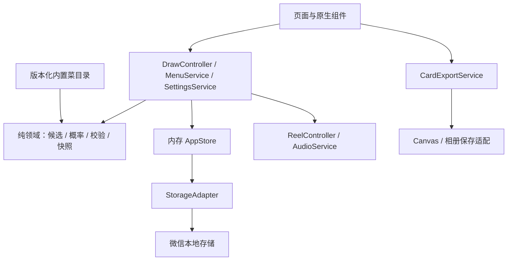
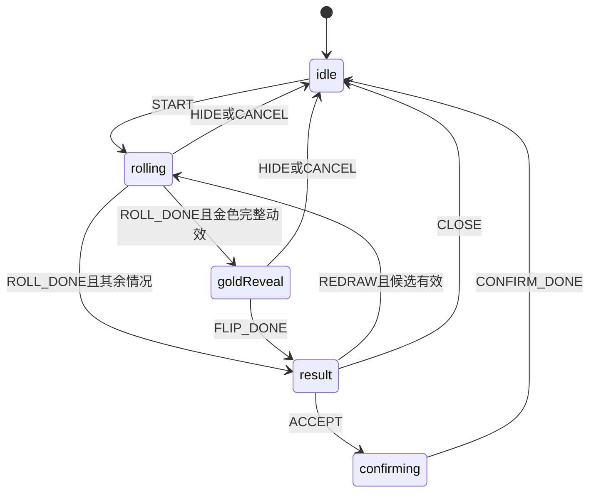

# 饭签｜微信小程序开发文档 V1.0

> 历史版本：首版实现已由[开发文档 V1.1](饭签_微信小程序开发文档_V1.1.md)取代。开发请使用 V1.1；本文件的自定义抽取菜单、纪念卡、海报导出等不再属于当前首版。

> 面向开发者的实现基线。依据《饭签_微信小程序产品方案_V1.0.md》，实现“打开即抽、菜品与品质独立、蓝紫红金揭晓”的本地小游戏。

| 项目 | 内容 |
|---|---|
| 日期 | 2026-10-08 |
| 文档状态 | 技术设计，尚未生成小程序代码或完成真机验证 |
| 产品暂定名 | 饭签 |
| 交付平台 | 微信小程序 |
| 首版技术路线 | 原生小程序 + TypeScript + WXML + WXSS |
| 数据范围 | 本地菜池、偏好、最近确认结果、最近稀有卡 |
| 服务端 | 首版无业务服务端、数据库或账号系统 |
| 参考代码 | truanayangi-com/truanayangi，提交 2e10968abfcee2cabc0b01fcf0535ac4aa31b16d |

本文件中的目录、接口、代码片段为拟实现方案，不代表仓库已经存在这些文件。技术规则不改变产品文档的概率、范围和交互；如需修改产品行为，先同步产品文档。示例代码须落地为完整模块并通过本文件规定的验证，不能当作已测试的成品。

## 1. 技术选型与开发准备

### 1.1 选型

| 层次 | 决定 | 原因 |
|---|---|---|
| 页面 | 原生 Page / Component、WXML、WXSS | 仅做微信单端，页面少，避免跨端适配负担 |
| 业务逻辑 | TypeScript 纯函数与服务 | 独立测试概率、去重、校验、状态迁移 |
| 状态 | 小型内存 store + 订阅 | 不引入大型状态库；storage 不充当运行时 store |
| 持久化 | wx 本地存储适配层 | 小量、版本化 JSON，不保存图片或音频二进制 |
| 动画 | WXSS transform / transition + 阶段控制器 | 不逐帧 setData，不依赖浏览器 DOM 或 React |
| 音频 | InnerAudioContext 适配层 | 统一管理静音、暂停与销毁 |
| 海报 | Canvas 2D + 临时图片导出 + 主动保存 | 本地制作固定结果卡，无远程服务依赖 |
| 单元测试 | 将纯 TS 编译到 Node 环境，使用 node:test | 测试不需要微信运行环境 |

不使用原网页的 Vite 页面入口、React 组件、Cookie、Web Audio 或 CSS DOM 查询方案。原项目的价格加权选择不复用：本版是当前候选菜等概率 + 独立品质概率。

### 1.2 环境初始化

1. 在微信开发者工具中新建原生 TypeScript 小程序项目，使用项目方自己的 AppID。
2. 先验证最小页面、一个原生组件、一次 TS 编译和真机预览，再开始功能开发。
3. 微信端编译使用开发者工具模板提供的 TS 支持；Node 端测试采用独立 tsconfig，不能用 Node 构建结果覆盖小程序源目录。
4. 开发工具、基础库、Node 和 TypeScript 版本在启动时验证后固定并写入 README；不在本文虚构“最新版本”。
5. 安装开发依赖后提交锁文件。运行时优先不引入第三方 UI 库、概率库和动画库。
6. 不提交个人开发工具配置、上传密钥、账号凭据或临时导出图片。

建议由后续实现的 package scripts 提供以下命令；本文未创建 package.json，不能直接把这些命令当作现成环境：

| 命令 | 实现职责 |
|---|---|
| npm run typecheck | 对小程序与纯领域代码做类型检查 |
| npm run test:domain | 编译纯业务与测试到 .test-dist，然后执行 node --test |
| npm run validate:catalog | 检查菜品数量、ID、名称、图片引用和默认菜单合法性 |
| npm run validate:assets | 检查资源清单、引用、尺寸预算与来源记录 |

## 2. 范围与模块架构

### 2.1 首版参数

| 配置 | 值 |
|---|---:|
| 内置菜数量 | 48 |
| 自定义菜上限 | 30 |
| 菜名长度 | 1–20 个 Unicode 码点 |
| 近期去重长度 | 3 |
| 蓝 / 紫 / 红 / 金概率 | 65% / 25% / 8% / 2% |
| 普通首抽 / 连续重抽时长目标 | 3000ms / 1500ms |
| 金色额外揭晓目标 | 1000ms |
| 简化动效上限 | 500ms |
| 稀有纪念卡数量 | 最近 1 张红或金 |

以上均为产品设计取值；时长和性能仍须真机验证。无保底、无付费、无广告解锁、无定位与餐厅接口、无账号同步。



依赖方向只向下。domain 不引用 wx、Page、Component、setData、Date.now 或 Math.random 全局实现；时间、随机源与 ID 通过参数传入。Controller 负责副作用，组件负责展示与发送意图。

### 2.2 推荐目录

```text
fanqian/
├─ README.md
├─ package.json
├─ package-lock.json
├─ project.config.json
├─ tsconfig.json
├─ tsconfig.test.json
├─ typings/
├─ docs/
│  ├─ product-v1.md
│  ├─ development-v1.md
│  └─ test-matrix.md
├─ miniprogram/
│  ├─ app.ts / app.json / app.wxss
│  ├─ pages/
│  │  ├─ home/index.{ts,json,wxml,wxss}
│  │  └─ menu/index.{ts,json,wxml,wxss}
│  ├─ components/
│  │  ├─ food-card/
│  │  ├─ draw-reel/
│  │  ├─ result-sheet/
│  │  ├─ settings-sheet/
│  │  ├─ rare-card-sheet/
│  │  └─ card-exporter/
│  ├─ domain/
│  │  ├─ types.ts
│  │  ├─ candidates.ts
│  │  ├─ draw.ts
│  │  ├─ validators.ts
│  │  └─ migrations.ts
│  ├─ data/catalog.v1.ts
│  ├─ config/rarity.ts
│  ├─ config/motion.ts
│  ├─ config/captions.ts
│  ├─ services/
│  │  ├─ draw-controller.ts
│  │  ├─ menu-service.ts
│  │  ├─ reel-controller.ts
│  │  ├─ audio-service.ts
│  │  └─ card-export-service.ts
│  ├─ store/app-store.ts
│  ├─ platform/
│  │  ├─ storage.ts
│  │  ├─ audio.ts
│  │  ├─ image-export.ts
│  │  └─ runtime.ts
│  └─ assets/{foods,ui,audio}/
├─ scripts/
│  ├─ validate-catalog.ts
│  └─ validate-assets.ts
├─ tests/{domain,services,fixtures}/
└─ assets-manifest.json
```

`index.{ts,json,wxml,wxss}` 表示四个文件。生成物 .test-dist、临时图片、个人配置加入忽略列表。

## 3. 数据结构

### 3.1 类型定义基线

```ts
export type Rarity = 'blue' | 'purple' | 'red' | 'gold';
export type DishSource = 'builtin' | 'custom';

export interface Dish {
  id: string;
  name: string;
  source: DishSource;
  artKey: string;
}

export interface Settings {
  soundEnabled: boolean;
  reducedMotion: boolean;
}

export interface ResultSnapshot {
  drawId: string;
  dishId: string;
  dishNameSnapshot: string;
  artKeySnapshot: string;
  rarity: Rarity;
  rarityConfigVersion: number;
  captionId: string;
  captionText: string;
  createdAt: number;
}

export interface RevealedResult extends ResultSnapshot {
  revealedAt: number;
}

export interface AcceptedResult extends RevealedResult {
  acceptedAt: number;
}

export interface PersistedStateV1 {
  schemaVersion: 1;
  catalogVersion: number;
  revision: number;
  disabledDishIds: string[];
  customDishes: Dish[];
  settings: Settings;
  lastAccepted: AcceptedResult | null;
  latestRare: RevealedResult | null;
}

export interface DrawSession {
  recentDishIds: string[]; // 从旧到新，仅保留最近三条
  skippedDishIds: Set<string>; // 只在内存，不直接 JSON 保存
  revealedCount: number;
}

export type DrawState =
  | { kind: 'idle' }
  | { kind: 'rolling'; result: ResultSnapshot }
  | { kind: 'goldReveal'; result: ResultSnapshot }
  | { kind: 'result'; result: RevealedResult }
  | { kind: 'confirming'; result: AcceptedResult };
```

`activeDrawId` 由 DrawState 中的 result 派生，避免两份 ID 状态不同步。保存状态、加载错误、页面可见性、动画 generation、定时器句柄属于运行态，不写入 PersistedStateV1。

ID 由 runtime 适配器生成，不能直接照搬浏览器 crypto.randomUUID。可采用启动实例随机串 + 毫秒时间 + 单调计数器的非安全 ID，并在自定义菜创建时检查碰撞；它不用于鉴权或奖品防伪。

### 3.2 校验要求

- 所有本地读取值按 unknown 处理，经 schemaVersion 分支验证后使用，不能直接类型断言。
- 菜名先 NFC 归一化、trim，再用 Array.from(name).length 检查 1–20 码点；控制字符拒绝。重复比较再做英文大小写归一化。
- 菜品 ID 非空唯一；customDishes 只能包含 source=custom，数量不超过 30。
- disabledDishIds 只能引用当前内置或自定义 ID，去重；删除自定义菜时同时清理其禁用引用。
- 快照不强制要求 dishId 仍在菜池中；校验快照自身的字段、长度、枚举和有效时间戳。失效 artKey 使用默认图。
- revision 为非负安全整数；latestRare 只允许 red / gold；未知更高 schemaVersion 进入保护模式，不静默降级覆盖。
- 暂不支持导入，所以无需设计通用文件导入接口。

## 4. 抽取算法

### 4.1 候选集合

处理顺序不能调换：所有菜 → 长期禁用 → 本轮明确跳过 → 最近三次 → 等概率选择。

```ts
export function candidates(
  pool: readonly Dish[],
  disabled: ReadonlySet<string>,
  session: DrawSession
): Dish[] {
  const enabled = pool.filter(d => !disabled.has(d.id));
  if (!enabled.length) throw new Error('EMPTY_POOL');

  const base = enabled.filter(d => !session.skippedDishIds.has(d.id));
  if (!base.length) throw new Error('SESSION_EXHAUSTED');

  const recent = session.recentDishIds.slice(-3);
  while (true) {
    const excluded = new Set(recent);
    const available = base.filter(d => !excluded.has(d.id));
    if (available.length) return available;
    recent.shift(); // 只释放最旧的近期记录，不修改长期与本轮排除
  }
}
```

base 已确保非空，所以最多释放三条记录即可结束。recentDishIds 允许同一 ID 重复；最近三次表示三次揭晓，不是最近三个不同菜名。

### 4.2 独立概率

```ts
type Random = () => number;

function unit(random: Random): number {
  const value = random();
  if (!Number.isFinite(value) || value < 0 || value >= 1) {
    throw new Error('INVALID_RANDOM');
  }
  return value;
}

export function pickRarity(r: number): Rarity {
  if (!Number.isFinite(r) || r < 0 || r >= 1) {
    throw new Error('INVALID_RANDOM');
  }
  if (r < 0.65) return 'blue';
  if (r < 0.90) return 'purple';
  if (r < 0.98) return 'red';
  return 'gold';
}

export function pickResult(items: readonly Dish[], random: Random) {
  if (!items.length) throw new Error('EMPTY_CANDIDATES');
  const dish = items[Math.floor(unit(random) * items.length)];
  const rarity = pickRarity(unit(random));
  return { dish, rarity };
}
```

落地时阈值应来自唯一的 rarity 配置模块，说明页也读取同一份配置，避免硬编码两份概率。上述片段用固定阈值方便审阅。

运行时可以为这个无现金价值的本地小游戏注入 Math.random；测试注入确定序列。使用连续两次随机取值，不复用同一取值同时计算菜与品质，也不在测试中用固定常数模拟“独立随机”。这里独立性是抽样设计，不承诺密码学随机或防作弊。

填充卡、文案与停点的装饰随机不得改变已经创建的结果。先将 dish、rarity、文案、drawId 和时间固定成不可变快照，再开始动画。客户端存储可被改动，首版不宣称可用于兑换或排名的可信凭证。

### 4.3 会话更新

- 完整揭晓后才加入 recentDishIds，并增加 revealedCount。
- “换一道”：保留会话，再调用创建抽取；蓝紫红金都重新抽。
- “这轮先跳过”：将当前 ID 加入 skippedDishIds，尝试开始下一次；全部跳过时停在提示状态。
- “以后不抽到”：修改长期禁用集合；只提示并提供撤销，不自动开始动画。
- “重新来一轮”：清空本轮近期与跳过记录，保留长期禁用。
- “就吃这个”：保存确认快照并重置会话；冷启动也重置会话。关闭结果弹层保留会话。
- 导航去菜单页面不清除已有会话；已删除的 ID 可从会话中清理，但旧快照不修改。

## 5. 状态机、生命周期与幂等



### 5.1 DrawController

Controller 维护 state、session、animationGeneration 与有效动画句柄。START 在同步进入 rolling 后才触发副作用，额外点击直接忽略。

每个动画完成回调捕获 `{drawId, generation}`。执行时同时检查：页面有效、generation 一致、当前状态允许此事件、当前 drawId 一致。任意不满足即返回。不能只用一个 spinning 布尔值。

`completeReveal(drawId)` 仅允许从 rolling / goldReveal 转到 result 一次；在这一点添加近期记录并更新红金纪念卡。不得在渲染组件 mounted 或动画定时器每次触发时保存。

`acceptResult(drawId)` 只允许 result 状态触发。同步转入 confirming 后写入 lastAccepted，重复操作被状态机挡住。保存失败仍代表本轮内存已接受，显示“本次可用，但未保存”，不能重新抽一个替代结果。

### 5.2 生命周期策略

| 时机 | 操作 |
|---|---|
| App 初始化 | 加载、验证、迁移状态；建立内存 store |
| 页面加载 | 订阅所需 view model；恢复声音设置后才开放交互 |
| 页面可见 | 标记 visible；不自动补播音效、不自动重抽 |
| 页面隐藏 | 停声音；取消进行中的滚动 / 翻面并使 generation 失效 |
| 页面卸载 | 取消订阅、清理计时器与动画、销毁页面持有资源 |
| App 隐藏 | 额外执行全局停止音频；操作须幂等 |

隐藏时已经完成的 result 保留内存，回来可继续接受；正在 confirming 时直接收尾到 idle，不能回滚已接受数据。调用相册相关操作可能触发应用切换，因此图片导出 generation 与抽取 generation 分开，不能因页面隐藏就删除已揭晓结果。

微信页面生命周期官方参考见文末 [S4]。不要把网页 visibilitychange 原样移植。

## 6. 页面与组件实现

### 6.1 页面合同

| 页面 / 组件 | 输入 | 事件 | 职责 |
|---|---|---|---|
| home | store 视图、DrawState | 抽取、接受、菜单导航 | 组合界面和 controller，不内联概率代码 |
| menu | 展示菜列表、保存状态 | 新增、编辑、启用、禁用、恢复 | 输入校验反馈和用户操作 |
| food-card | 固定卡面 view model | 无 | 蓝紫红金图形与品质文字 |
| draw-reel | ReelPlan、runToken、动效设置 | complete / error | 根据计划移动，不计算业务结果 |
| result-sheet | RevealedResult | accept / redraw / skip / disable / close | 已揭晓结果操作 |
| settings-sheet | Settings、概率配置 | change | 声音、简化动效、概率说明 |
| rare-card-sheet | latestRare | export / close | 读取单张快照 |
| card-exporter | 固定结果快照 | saved / failed / denied | 隔离 Canvas 和保存流程 |

页面 data 只包含 WXML 需要的普通可序列化值；Set、控制器、音频实例、句柄不能放进 data。setData 只发送变化字段，不能在每帧发送整份菜池。

### 6.2 菜单操作

编辑表单使用局部 draft。输入每个字符不写 storage，点击保存才提交。启用开关可以即时提交；失败时保持本次内存值但显示“未保存”。关闭表单不丢掉尚未提交的输入需要明确的取消行为；首版可在关闭时直接丢弃表单 draft，已经提交的菜单状态不回退。

重复名字包含所有内置及自定义项，包括禁用项。新增“已被禁用的内置菜名”应提示去恢复，不能制造第二份。

恢复默认菜单仅启用全部内置条目，保留自定义菜及其禁用状态。永久删除自定义菜需要明确删除动作；删除后不修改 lastAccepted 和 latestRare 的快照。

## 7. 转盘与金色揭晓

### 7.1 ReelPlan

```ts
interface ReelPlan {
  runToken: string;
  cells: Array<{ slotId: string; artKey: string; label: string; rarity: Rarity }>;
  winnerIndex: number;
  durationMs: number;
  endTranslatePx: number;
  goldFlip: boolean;
}
```

计划由已固定结果生成。金色结果在滚动条中使用问号卡，翻面后使用真实菜品；蓝紫红直接展示真实中奖卡。装饰卡不进入结果、历史或纪念卡。

第一版采用有限长度卡带：先以 24–36 张为性能验证起点，只在两次抽取之间重置。若真机不达标再减少或做可见区窗口化，不一开始复刻网页无限世界坐标。

卡片宽度 w、间隔 g、视窗宽度 W、中奖索引 k 均使用测量后的同一单位 px：

`endTranslateX = W / 2 - (k * (w + g) + w / 2)`

如果存在轨道左内边距，必须把它加入卡片中心计算。不能混用 rpx 与 px。首版固定停在中奖卡中心，降低不同机型错位风险。

### 7.2 动画控制

1. 测量舞台尺寸并生成计划。
2. 无过渡地设置起点和卡带；待渲染状态生效后启动 transform 过渡。
3. 启动时间使用控制器时钟；事件与兜底计时都携带 runToken，完成逻辑只能执行一次。
4. 过渡完成事件必须过滤目标节点 / 属性；目标基础库行为由技术验证确认。不支持可靠事件时使用受控时间线收尾并校验最终视觉位置。
5. 设置有限的动画结束兜底（设计值：计划时长再加 500ms）；仍可见时直接对齐终点并揭晓，不重新随机。
6. 金色接续约 1000ms 的自动翻面；简化动效跳过滚动与翻面，500ms 内进入结果。

禁止每 16ms 调用 setData 移动列表。取消时清理定时器和 runToken，即使平台动画回调迟到也不得授予结果。

音效采用有限的启动 / 滚动提示 / 揭晓声音；首版不必逐卡触发音效。不要为了装饰频繁新建音频对象，也不人为把红金填充卡布置到中奖格旁边制造假“差一点”。

## 8. 音频实现

AudioService 提供 init(settings)、play(kind)、setMuted(boolean)、stopAll()、dispose()。默认无需在页面打开时播放任何声音，只响应用户抽取。

使用 `wx.createInnerAudioContext`，声音加载失败静默降级，记录资源 key 和错误分类，不阻断动画。短音效可在兼容验证后使用 `useWebAudioImplement`；官方文档标注该参数有最低版本要求，初始化失败应回退到普通实现。所有不再使用的实例须调用 destroy 释放。[S3]

建议只创建少量可复用实例：启动 / 滚动一组、揭晓一组；具体并发数量在真机验证时定。静音状态必须同步到 service，而不只修改按钮图标。

测试重点：静音→关闭→打开→抽取始终无声；切后台立刻停止；返回不补播；连续 100 次抽取实例数不持续增加。不要承诺覆盖用户系统静音或强制绕过设备声音设置。

## 9. 本地状态与迁移

### 9.1 存储布局

主 key 使用 `fanqian.app-state`；schemaVersion 写在对象中。首版小对象使用同步读写适配，限于启动和用户动作提交，不在动画期间高频调用。微信官方明确 storage 用于持久化而不是运行态传递，且同步读写过多会影响启动。[S1]

建议把应用自身状态控制在 100KB 内作为工程预算，不把平台容量上限当目标。图片、音频、Canvas 对象、临时文件路径和会话 Set 都不入库。

### 9.2 更新流程

`读取当前内存 → 执行业务修改 → 完整校验 → revision + 1 → 更新内存 → 尝试持久化 → 通知页面保存状态`

Store 为唯一写入者。所有页面先提交意图，不能基于旧页面副本覆盖整份状态。失败保留新内存，dirty=true；后续用户动作或手动重试保存最新整体状态，不重试已经过期的旧对象。不用刷新本地读取覆盖尚未保存的内存。

同步写入放在 try/catch 中；首次实现验证可在写后读取并比较 schemaVersion 与 revision，再标记成功。平台调用返回成功并不构成永不丢失承诺。

### 9.3 启动状态区分

| 情况 | 行为 |
|---|---|
| key 不存在 | 创建默认内存状态，首次必要提交时保存 |
| 当前版本合法 | 正常恢复 |
| 已知旧版本 | 在内存迁移、完整校验后写新值；写失败保留旧磁盘数据 |
| 字段部分无效 | 展示可恢复的有效部分，但进入 recoveryRequired，暂停自动写入原 key |
| 结构损坏或未知未来版本 | 默认内存可体验；提示恢复，未获用户明确恢复前禁止自动覆盖 |

recoveryRequired 下接受、抽取或改设置均只影响内存，不能因为随后一次普通动作就隐式覆盖损坏原值。用户明确选择“恢复并保存”后才解除保护并写入。首版无数据库事务、远程重试或队列。

目录更新：按 ID 保留用户排除；删除失效禁用引用；自定义菜保持不变；结果快照不重新查询新名称。schemaVersion 与 catalogVersion 分别管理结构和内容，不混用。

## 10. 稀有纪念卡与结果图片

### 10.1 纪念卡规则

完整揭晓 red / gold 时更新 latestRare；下一次 blue / purple 不覆盖。后续 red 也会覆盖旧 gold，因为产品定义是“最近稀有卡”，不是“最好的一张”。没有后台、云图库或收藏数量扩展。

快照保留菜名、品质、文案、图片 key、时间；删除自定义菜不影响查看。历史图片 key 找不到时用默认食物图，不生成新随机文案。

### 10.2 图片流程

状态：idle → rendering → ready → saving → saved / denied / failed。

建议首版输出一张固定尺寸 PNG，例如 750×1000 像素；这是设计尺寸，不是平台限制。仅使用本地资源与统一模板，不截屏整个页面。

1. 用户点击保存，冻结传入的 ResultSnapshot，创建独立 exportToken。
2. 等待 Canvas 节点与所需图片加载完成，按确定模板绘制。长菜名换行，最多两行，按实际绘制宽度截断并留出边距。
3. Canvas 2D 路径使用节点实例传入 `wx.canvasToTempFilePath` 的 canvas 参数；不要混用旧 CanvasContext 的 canvasId / draw 回调套路。[S2]
4. 得到 tempFilePath 后调用 `wx.saveImageToPhotosAlbum`。官方接口要求本地临时或永久图片路径，不接受网络 URL，并需要 `scope.writePhotosAlbum` 授权。[S5]
5. 保存完成才显示“已保存”；拒绝授权保留卡片，用户可取消或主动前往设置处理。不在启动时申请相册权限、不反复自动弹出请求。

旧式 CanvasContext 若作为兼容方案，需按其绘制完成回调再导出；两种渲染实现放在同一适配接口后，不能拼接两套 API 代码。具体最低基础库与相册设置跳转流程在技术验证时落实。

导出过程中再抽一次不能改变正在导出的快照；重复点击只执行一次导出。临时图片路径不保存在纪念卡里，重新打开可重新生成。

## 11. 素材、配置与内容校验

- data/catalog.v1.ts 维护 48 道内置菜，首版发布前需补齐名单、短句与图片。不得误把参考仓库的 128 道越南菜整体视为已确认菜单。
- artKey 映射到素材清单，避免数据项散落绝对路径；默认图始终存在。
- rarity.ts 为唯一概率源，包含 configVersion、四档权重、标题与颜色；UI 与算法共用。
- motion.ts 单独配置首抽、重抽、金色与简化动效时长。
- captions.ts 提供可复用模板，随机选定后生成 captionText 快照。不要使用依赖分词才能工作的大量复杂模板。
- assets-manifest.json 记录文件、用途、来源、授权或原创说明及尺寸。CS 原声与参考项目图片未经确认不进入发布包。
- 包体限制与分包策略在开发者工具中核验当期要求；本文不写死未经核验的容量。素材体积过大先压缩和去重，再考虑分包，不先引入远程 CDN。

## 12. 测试计划

### 12.1 自动化测试

| 模块 | 必测用例 | 判定 |
|---|---|---|
| 品质 | 0、0.649999、0.65、0.899999、0.90、0.979999、0.98、0.999999 | 四档边界精确命中 |
| 随机校验 | -1、1、NaN、Infinity | 拒绝无效随机值 |
| 菜品等概率 | 每个等分区间中点与边界 | 命中预期索引，无越界 |
| 独立抽样 | 随机桩返回 [菜取值, 品质取值]，分别只改其中一个 | 另一个维度不变 |
| 候选 | 0 / 1 / 2 / 3 / 4 道、重复近期 ID、本轮全跳过 | 正确报错或最旧逐步释放 |
| 状态机 | 连点 20 次、重复完成、过期回调、中断后重抽 | 只完成一个合法结果 |
| 菜单 | NFC、空白、英文大小写、控制字符、20/21 码点、30/31 道 | 校验与错误信息一致 |
| 存储 | 读失败、写失败、损坏、未知未来版本、迁移失败 | 不静默丢数据或显示假成功 |
| 快照 | 菜改名 / 删除、红盖金、蓝不盖红 | 历史稳定且覆盖规则正确 |
| 图片 | 导出中重抽、重复点击、权限拒绝 | 固定快照且核心流程可继续 |

随机统计可作为补充诊断，不能替代边界测试，也不要使用小样本“必须出现一次金色”这种易波动断言。正式通过标准以确定输入、状态事件和不变量为主。

### 12.2 真机矩阵

至少一台 iOS 与一台 Android，包含一台性能较低设备；记录型号、系统、微信版本和基础库版本。测试：首次进入、热返回、后台中断、横竖屏 / 尺寸变化、系统声音行为、字体缩放、相册授权拒绝与恢复、断网、资源故障、连续 100 次抽取。

性能目标沿用 PRD：准备好后点击至视觉反馈目标不超过 100ms，每台 20 次并记录分布；普通首抽约 3 秒、重抽约 1.5 秒；无明显残留声音、错位中奖格或多次弹结果。开发者工具正常不能替代真机结论。

### 12.3 与产品验收映射

| 产品验收 | 开发测试范围 |
|---|---|
| AC-001、AC-011、AC-014 | 初始化、菜单、版本迁移 |
| AC-002–AC-006、AC-018 | 概率、候选、说明配置同源 |
| AC-007–AC-010 | 状态机、动画、生命周期、声音 |
| AC-012–AC-013 | 接受幂等与保存失败 |
| AC-015–AC-016 | 纪念卡、固定海报与权限失败 |
| AC-017 | 真机性能与稳定性 |

## 13. 开发阶段与交付检查点

| 阶段 | 工作 | 退出条件 |
|---|---|---|
| M0 技术验证 | 原生 TS 项目、真机、transform、音频、Canvas 导出与保存 | 记录版本与机型，单张示例卡可保存 |
| M1 纯逻辑 | 类型、候选、概率、校验、会话、状态机 | 领域与控制器核心测试通过 |
| M2 可用闭环 | 首页、结果、菜单、本地 store、错误提示 | 不依赖美术也能完整抽取 / 接受 / 调整 |
| M3 游戏表现 | 卡带、四档品质、金色翻面、声音与简化动效 | 真机无错位、无中断旧回调、静音恢复正确 |
| M4 趣味增强 | 最近稀有卡、海报保存、资源和文案补齐 | P1 验收完成 |
| M5 发布准备 | 真机回归、内容校验、素材说明、小范围试用 | P0 全通过，P1 状态明确，体验问题有记录 |

不在缺少人员投入和素材工作量的情况下承诺天数。先完成 M0 再估算排期；阶段内每次只扩展一个可验证闭环。

实现完成应交付：源码与锁文件、开发 README、环境版本、48 道菜单与资源清单、自动化测试结果、真机矩阵、构建 / 上传操作说明、已知限制。本文本身不是这些开发成果的完成证明。

## 14. 发布与后续边界

发布前使用项目自己的 AppID 与发布账号，按平台当期要求核验类别、隐私说明及所用接口。无服务端不等于可以跳过平台检查。本次仅出开发文档，不代替发布审核，也不执行上传。

不做付费抽奖、现金或实物奖品、卡片交易，不把客户端结果用于可信排名。不提前加入云开发、数据库、登录或反作弊服务器。若后续引入这些功能，应单独修订架构和产品范围。

升级版本必须保留稳定菜品 ID 和可迁移状态。回滚遇到高版本 schema 时禁止旧代码覆盖新数据；发布前用旧版 / 新版 fixture 验证这一点。

仍需开发启动时确定：正式名称、美术规范、48 道完整菜单、确切工具与基础库版本、真机清单。它们不影响本文的核心算法和模块边界，但在上线前必须补齐。

## 15. 官方资料与核验说明

以下官方页面于 2026-10-08 读取核对。只把文档中实际核对的接口行为作为依据，不据此推断全部平台发布政策；实际开发仍需核验所选基础库和设备支持。

- [S1：wx.setStorageSync，本地缓存与存储注意事项](https://developers.weixin.qq.com/miniprogram/dev/api/storage/wx.setStorageSync.html)
- [S2：wx.canvasToTempFilePath，Canvas 图片导出](https://developers.weixin.qq.com/miniprogram/dev/api/canvas/wx.canvasToTempFilePath.html)
- [S3：wx.createInnerAudioContext，音频创建与资源释放](https://developers.weixin.qq.com/miniprogram/dev/api/media/audio/wx.createInnerAudioContext.html)
- [S4：页面生命周期](https://developers.weixin.qq.com/miniprogram/dev/framework/app-service/page-life-cycle.html)
- [S5：wx.saveImageToPhotosAlbum，本地路径与相册授权](https://developers.weixin.qq.com/miniprogram/dev/api/media/image/wx.saveImageToPhotosAlbum.html)

开发主线：先把菜池、概率和状态写对，再把出金体验做好；任何动画、声音或保存失败都不应制造另一份抽取结果。
